# AI 网页 PPT 生成器

粘贴一段长文案 → 后端**流式**调用大模型把它拆解成多页 PPT 结构 → 前端**实时**显示生成进度，
最终渲染成可**全屏演示、键盘翻页**的网页 PPT，支持多套配色主题，并可**导出为独立 HTML**、**真正的 `.pptx`（PowerPoint）**，
以及**扫码在手机上使用 / 微信小程序**。

- 模型：`deepseek-v4-pro`（OpenAI 兼容协议，`base_url = https://api.deepseek.com/v1`）
- 后端：Node.js + Express 5（ESM，无构建步骤），SSE 流式推送
- 前端：React 19 + TypeScript + Vite 8
- 小程序：原生微信小程序（`miniprogram/`），与网页共用同一套 SSE 接口与主题
- 导出：自包含 HTML · Office Open XML `.pptx`（pptxgenjs）· 结构 JSON
- 测试：`node:test`（单元 / 集成）+ Playwright（浏览器端到端）+ PowerPoint COM 校验 + 真实接口验收

---

## 快速开始

```bash
npm install
cp .env.example .env               # 填入 DEEPSEEK_API_KEY
npm run dev                        # http://127.0.0.1:8787 （Vite HMR + API 同一个端口）
npm run miniprogram:config         # 可选：把小程序的后端地址写成当前电脑的局域网地址
```

生产模式：

```bash
npm run build             # 产物输出到 dist/
npm start                 # Express 同时提供 API 与静态资源
```

准备发布小程序时，用 `HOST=0.0.0.0` 启动让手机能访问，并把 `WX_APPID` / `WX_SECRET` 填进 `.env`，
网页右上角「扫码使用」就会从「网页版二维码」自动切换成真正的**微信小程序码**。

### 环境变量（`.env`）

| 变量 | 默认值 | 说明 |
| --- | --- | --- |
| `DEEPSEEK_API_KEY` | — | **必填**，缺失时接口返回 503 并在界面提示 |
| `DEEPSEEK_BASE_URL` | `https://api.deepseek.com/v1` | OpenAI 兼容地址 |
| `DEEPSEEK_MODEL` | `deepseek-v4-pro` | 模型 id |
| `DEEPSEEK_EFFORT` | `low` | 推理档位（`low` / `high` / `max`），`low` 响应更快 |
| `DEEPSEEK_TEMPERATURE` | `0.6` | 采样温度 |
| `DEEPSEEK_MAX_TOKENS` | `8000` | 单次生成上限 |
| `PORT` / `HOST` | `8787` / `127.0.0.1` | 监听地址（手机/小程序访问需要 `HOST=0.0.0.0`） |
| `MIN_CHARS` / `MAX_CHARS` | `20` / `20000` | 输入长度校验 |
| `MAX_SLIDES` | `24` | 页数硬上限 |
| `REQUEST_TIMEOUT_MS` / `IDLE_TIMEOUT_MS` | `300000` / `90000` | 总超时 / 静默超时 |
| `WX_APPID` / `WX_SECRET` | — | 微信小程序 AppID/Secret，配置后 `/api/miniprogram/code` 返回真正的小程序码 |
| `WX_ENV_VERSION` | `release` | 小程序码指向的版本：`release` / `trial` / `develop` |
| `WX_PAGE` | `pages/index/index` | 小程序码打开的页面 |
| `WX_API_BASE` | `https://api.weixin.qq.com` | 微信开放接口地址（测试时可指向 mock） |
| `PUBLIC_URL` | 自动探测局域网 IP | 扫码回退地址 / 反向代理后的对外域名 |
| `MINIPROGRAM_API_BASE` | 自动探测局域网 IP | 提示用户填进 `miniprogram/config.js` 的地址 |
| `PPTX_FONT` | `Microsoft YaHei` | 导出 PPTX 使用的字体（中文必须显式指定，否则会变豆腐块） |

> 环境变量优先于 `.env` 文件（Node `process.loadEnvFile` 语义），因此 CI/测试可以安全地覆盖配置。

---

## 架构

```
浏览器 ──fetch POST /api/generate──▶ Express ──SSE──▶ 浏览器（实时进度）
微信小程序 ──wx.request(enableChunked)──▶  ┘   │
                                              └──stream:true──▶ api.deepseek.com/v1

导出：浏览器 / 小程序 ──POST /api/export/pptx──▶ Express(pptxgenjs) ──▶ .pptx
扫码：浏览器 ──GET /api/miniprogram/code──▶ 小程序码(需 WX_APPID) 或 H5 二维码
```

```
server/
  index.js          启动入口（含优雅退出、局域网地址提示）
  app.js            组装 Express：API → 静态资源/SPA 回退 → 错误处理
  config.js         .env 加载与配置（可被测试覆写）
  deepseek.js       OpenAI 兼容的流式客户端（reasoning / content / usage 分流、超时、中断）
  prompt.js         系统提示词：要求模型输出 NDJSON，先 meta 再逐页
  parser.js         容错流式解析器（见下）
  deck.js           幻灯片规范化与校验（布局推断、字段降级、限额、去重）
  themes.js         主题的唯一来源：在沙箱里求值播放器运行时，读取同一份 THEMES
  pptx.js           导出真正的 .pptx（1280x720 设计画布 1:1 映射到 13.333x7.5 英寸）
  routes/generate.js  SSE 接口：校验 → 转发 → 边收边解析 → done
  routes/export.js    pptx 导出 / 小程序码 / 局域网信息
web/src/
  player/runtime.js 播放器运行时（经典脚本，App 与导出文件共用同一份代码）
  player/slide.css  幻灯片 / 播放器样式（同样被导出文件内联）
  lib/player.ts     把 runtime.js 源码注入 <script> 并暴露 API
  lib/api.ts        SSE 客户端（fetch + ReadableStream，可取消）
  lib/exportPptx.ts 调服务端导出 .pptx
  lib/useGeneration.ts  生成状态机（进度、日志、取消）
miniprogram/        原生微信小程序（详见下文）
  utils/utf8.js     增量 UTF-8 解码（小程序没有 TextDecoder，且多字节会被分块切断）
  utils/sse.js      SSE 分帧
  utils/api.js      流式生成 / 导出 pptx / 打开文件
  components/slide/ 幻灯片渲染组件（1280x720rpx 设计画布 + 主题类）
  pages/{index,deck,player,about}/
```
  lib/exportHtml.ts 生成自包含 HTML / JSON 并触发下载
  components/       Editor / ProgressView / DeckView / PlayerOverlay / SlidePreview / ThemePicker
```

### 为什么用 NDJSON + 容错解析

提示词要求模型**每行一个 JSON 对象**（第一行 `meta`，之后每页一行）。好处是每完成一页就能立刻推给前端，
而不是等整份 JSON 结束。但真实模型会跑偏，所以 `server/parser.js` 采用了一个**单遍括号扫描器**：

* 维护一个「当前打开的 `{`」栈，任何**已闭合**的 JSON 对象立刻被解析和分类 → 天然按页流式输出；
* 字符串内的 `{` `}` 与转义字符被正确忽略；
* 兼容三种形态：纯 NDJSON、单个 `{"slides":[...]}` 大文档、被 ``` 包裹或被说明文字包围的输出；
* **深度判断**：只有顶层对象（或带 `layout` / 幻灯片级字段的嵌套对象）才会成为一页，
  因此 `columns` / `stats` / `steps` / `quote` 里的子对象不会被误当成新页面；
* 被 `max_tokens` 截断的最后一页会被直接丢弃，而不是污染整份 PPT；
* 流结束后再用一次整体 `JSON.parse` 校正，若模型返回的是一个完整文档，则以它为准。

`server/deck.js` 再把任意输入规范成固定结构：布局别名映射（`要点` → `bullets`、`对比` → `two-column`…）、
字段名兜底（`heading`/`headline`/`name` 都当标题）、布局降级（数据缺失时退回 `bullets`）、
长度与数量裁剪、去重，并自动补齐封面与结尾页。

### 播放器运行时为什么是一个文件

`web/src/player/runtime.js` 刻意写成一个**经典脚本**（不含 `import`/`export`）：

* App 侧把它作为文本注入 `<script>`，从 `window.PPTPlayer` 取 API；
* 导出功能把它原样内联进 HTML 文件。

于是「编辑器预览 / 全屏演示 / 导出的独立文件」跑的是**完全同一份渲染代码**，
缩略图、演示模式、导出结果三者视觉一致，不存在两套实现走样的问题。

---

## 功能

* **输入**：长文案粘贴框（字数校验、草稿本地保存、内置示例）；目标页数（6–16）与输出语言可选。
* **流式生成**：`status / meta / slide / progress / reasoning / raw / usage / done / error` 事件；
  前端显示阶段日志、进度条、已解析页数 / 用时 / 字符数 / tokens，并可展开查看模型思考过程与原始 NDJSON。
* **实时预览**：每解析出一页立即出现缩略图，无需等待全部完成。
* **演示模式**：全屏、键盘翻页（`←` `→` `↑` `↓` `空格` `PageUp/Down` `Home` `End` `J/K`）、
  `F` 全屏、`T` 切换主题、`N` 演讲备注、`Esc` 退出，进度圆点可点击跳页，移动端支持左右滑动。
* **配色主题（5 套）**：简约白、深空蓝、暖阳赤陶、墨绿森野、霓虹夜色，可随时切换。
* **导出三种格式**：
  * **独立 HTML**：内联 CSS + 运行时 + 数据，零外部请求，可离线打开并继续翻页/换主题；另带 `@media print` 便于打印成 PDF；
  * **PowerPoint `.pptx`**：服务端用 Office Open XML 生成真正的 Office 文件（13.333×7.5 英寸 16:9 宽屏、可编辑、带演讲者备注），网页与小程序共用同一个接口；
  * **结构 JSON**：仅数据，便于二次加工。
* **扫码使用**：网页右上角「扫码使用」弹窗给出二维码 —— 配置了 `WX_APPID`/`WX_SECRET` 时是真正的**微信小程序码**，否则回退为可直接用手机打开的**网页版二维码**（指向局域网地址）。
* **响应式**：幻灯片是固定 1280×720 设计画布，运行时按视口等比缩放，桌面 / 平板 / 手机布局一致；
  窄屏下编辑器改为单列、主题选择器收成色块、播放器 HUD 自动精简。

### API

| 方法 | 路径 | 说明 |
| --- | --- | --- |
| `GET` | `/api/health` | 模型、base_url、是否已配置 Key / 微信凭据 |
| `POST` | `/api/generate` | `{ text, options: { targetSlides, language, theme } }` → `text/event-stream` |
| `GET` | `/api/export/formats` | 可用导出格式与主题列表 |
| `POST` | `/api/export/pptx` | `{ deck, theme }` → `application/vnd.openxmlformats-officedocument.presentationml.presentation` |
| `GET` | `/api/miniprogram/code` | 扫码入口：小程序码或 H5 二维码（JSON + base64 PNG） |
| `GET` | `/api/miniprogram/qr.png` | 同一张二维码的原始 PNG |
| `GET` | `/api/network` | 局域网地址与建议填进小程序 `config.js` 的 API 地址 |

SSE 事件示例：

```
event: meta      data: {"meta":{"title":"…","slideCount":8}}
event: slide     data: {"index":2,"slide":{"layout":"stats","title":"…"},"count":3}
event: progress  data: {"slides":3,"total":8,"elapsedMs":9120,"tokens":null}
event: done      data: {"deck":{…}}
```

---

## 微信小程序端

`miniprogram/` 是一个完整的原生小程序工程，与网页端**共用同一个后端、同一套 SSE 协议、同一份主题色**。

| 页面 | 作用 |
| --- | --- |
| `pages/index` | 粘贴文案、选页数/语言/主题、流式生成（阶段日志 + 进度条 + 每页实时预览） |
| `pages/deck` | 页面总览、切主题、开始演示、导出 PPTX、复制 JSON、分享 |
| `pages/player` | 全屏演示：点两侧翻页、左右滑动、进度点跳页、🎨 换主题、📝 看备注、⤓ 导出 |
| `pages/about` | 使用说明与后端连通性自检 |

### 怎么跑起来

1. **启动后端**（让手机能访问）：
   ```bash
   HOST=0.0.0.0 npm run dev          # Windows PowerShell: $env:HOST="0.0.0.0"; npm run dev
   npm run miniprogram:config        # 把 miniprogram/config.js 的 API_BASE 写成局域网地址
   ```
   服务启动日志会打印局域网地址，例如 `http://192.168.1.15:8787`。
2. **用微信开发者工具**「导入项目」，目录选择仓库里的 `miniprogram/`，AppID 填你自己的（或选「测试号」）。
3. 开发阶段勾选 **「不校验合法域名、web-view（业务域名）、TLS 版本以及 HTTPS 证书」**
   （`project.config.json` 里已预设 `"urlCheck": false`）。
4. 点预览/真机调试即可在手机上使用；正式发布需要 **HTTPS + 已备案域名**，并在微信公众平台配置 request 合法域名。

### 实现要点（为什么这么写）

* **流式收流**：`wx.request({ enableChunked: true })` + `requestTask.onChunkReceived`（基础库 2.20.2 / 2.20.1）。
  基础库过低时自动退化为一次性响应，功能仍可用。
* **手写 UTF-8 解码**（`utils/utf8.js`）：小程序没有 `TextDecoder`，而一个中文字符占 3 字节，
  网络分块必然把它**切成两半**，所以解码器会把不完整的尾部字节留到下一个分块。
  这一条有专门的单元测试（按 1..17 字节切分同一段中文，必须逐字节还原）。
* **分块传输用纯类名主题**（`styles/themes.wxss`）：微信官方文档并未承诺 WXSS 支持 CSS 变量
  `var()`，所以小程序端不使用变量，而是由 `npm run sync:themes` 从 `web/src/player/runtime.js`
  （网页/导出 HTML/PPTX 的唯一主题来源）**生成** `.t-<主题>` 类；单元测试会在生成文件过期时报错。
* **导出 pptx**：小程序不能自己写 OOXML，因此调 `POST /api/export/pptx` 拿到二进制，
  用 `FileSystemManager.writeFile` 写入 `wx.env.USER_DATA_PATH`，再交给
  `wx.openDocument({ fileType: 'pptx', showMenu: true })`（微信官方支持列表里包含 `pptx`），
  用户可以直接转发给好友或用其它应用打开。
* **演示缩放**：幻灯片组件按 1280×720rpx 的固定画布绘制（数值与网页 `slide.css` 的 px 一一对应），
  页面用 `transform: scale(k)` 按屏幕宽高等比缩放，横竖屏都不会溢出。

---

## 界面预览

全部截图由 `node scripts/screenshot.mjs` 用**真实模型**跑通一遍流程后自动生成（见 `docs/screenshots/`）。

| 输入文案 | 流式生成（实时预览） |
| --- | --- |
| 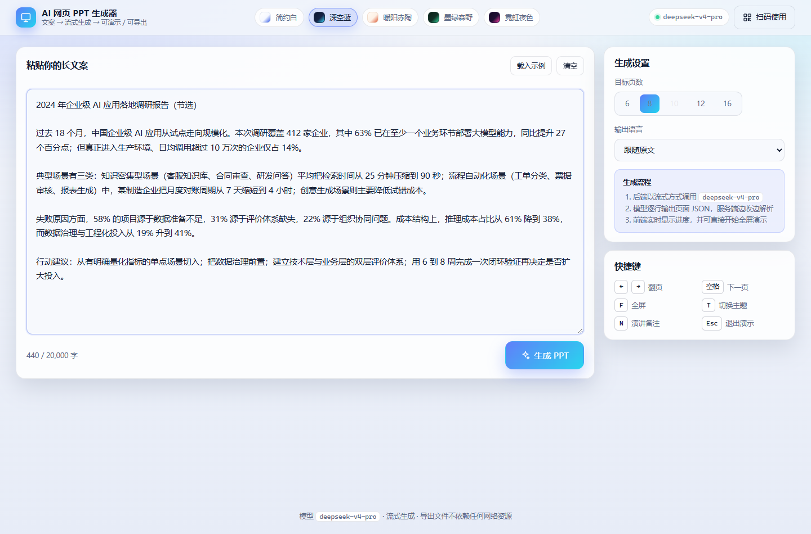 | 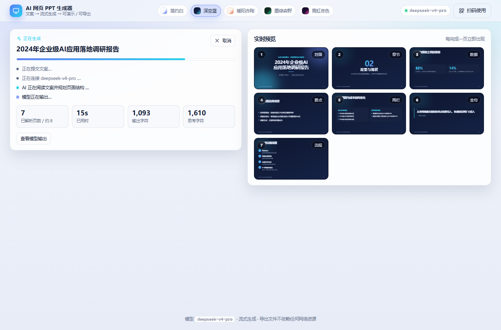 |

| 生成完成 · 页面总览 | 全屏演示 |
| --- | --- |
| 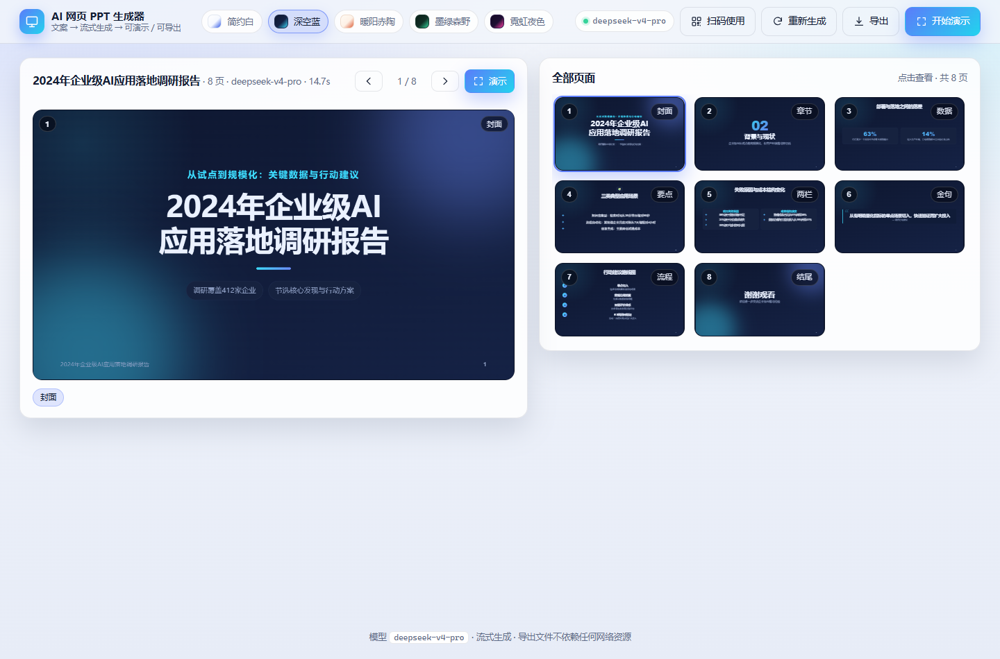 | 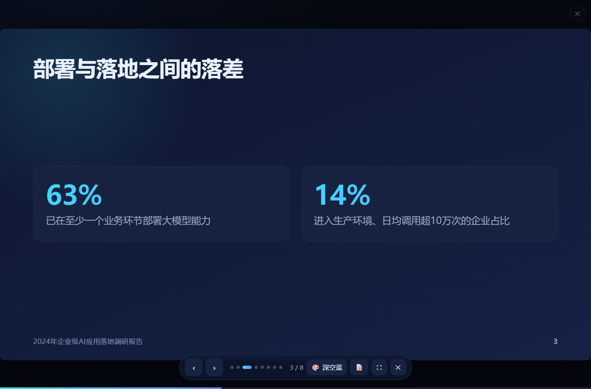 |

| 主题：简约白 | 主题：暖阳赤陶 | 主题：墨绿森野 |
| --- | --- | --- |
| 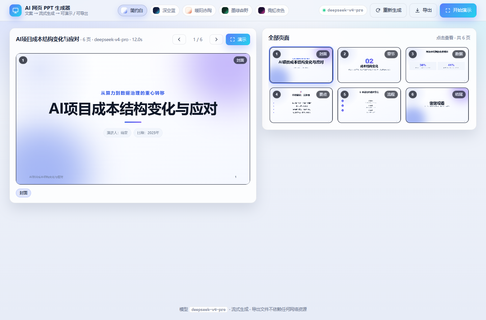 | 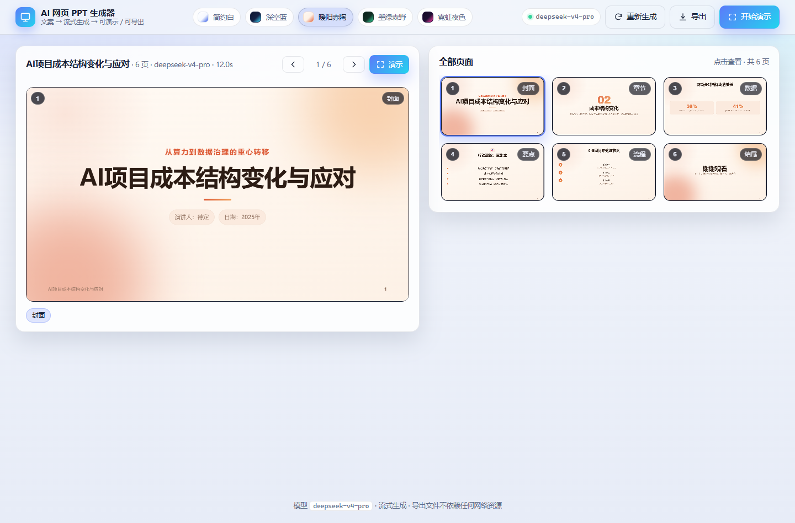 | 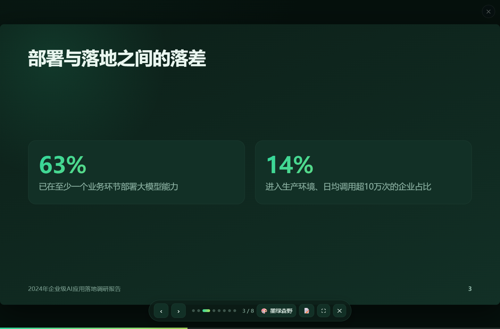 |

| 手机（竖屏，含旋转提示） | 手机（横屏） | 导出的独立文件（离线打开） |
| --- | --- | --- |
| 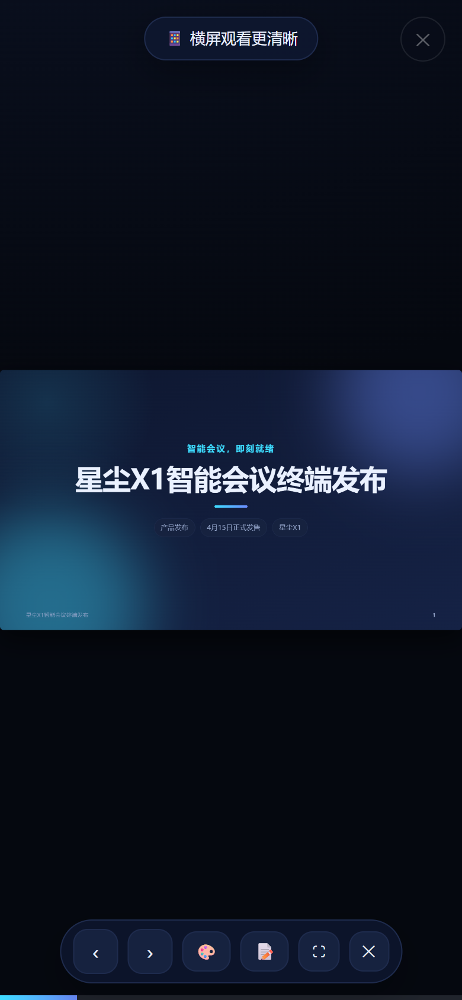 |  |  |

| 导出菜单（HTML / PPTX / JSON） | 扫码使用（小程序入口 / 网页版回退） |
| --- | --- |
| 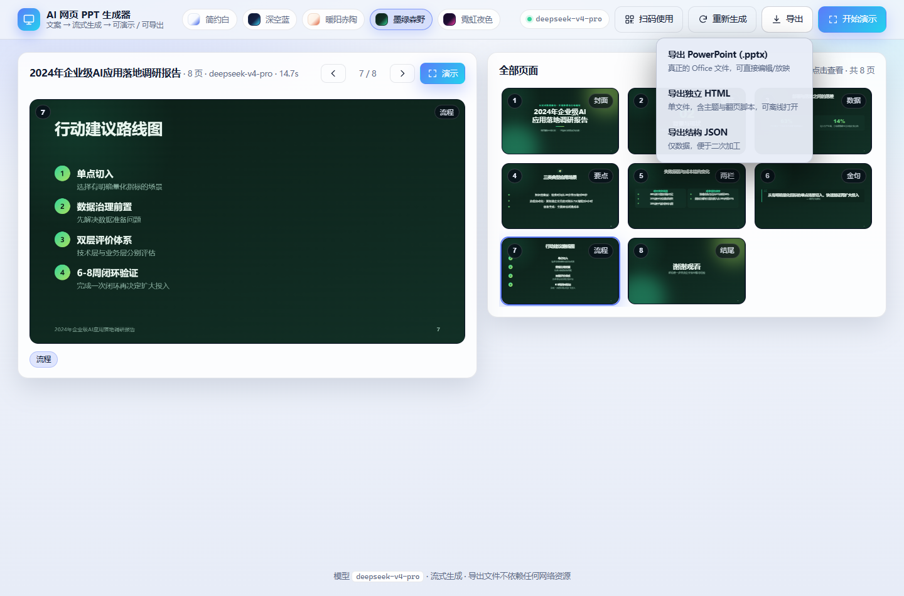 | 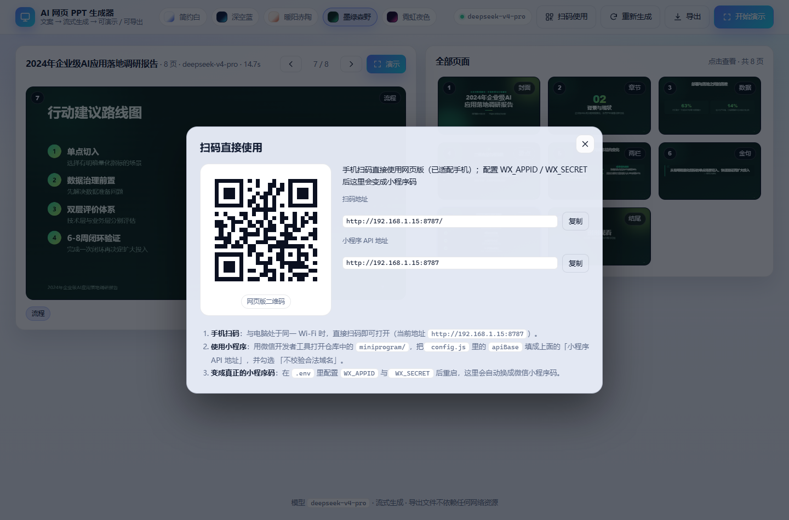 |

导出的 `.pptx` 由 **Microsoft PowerPoint 亲自渲染**（`npm run pptx:validate -ExportPng`）：

| 封面（深空蓝） | 数据页（深空蓝） | 流程页（深空蓝） | 两栏页（简约白） |
| --- | --- | --- | --- |
|  | 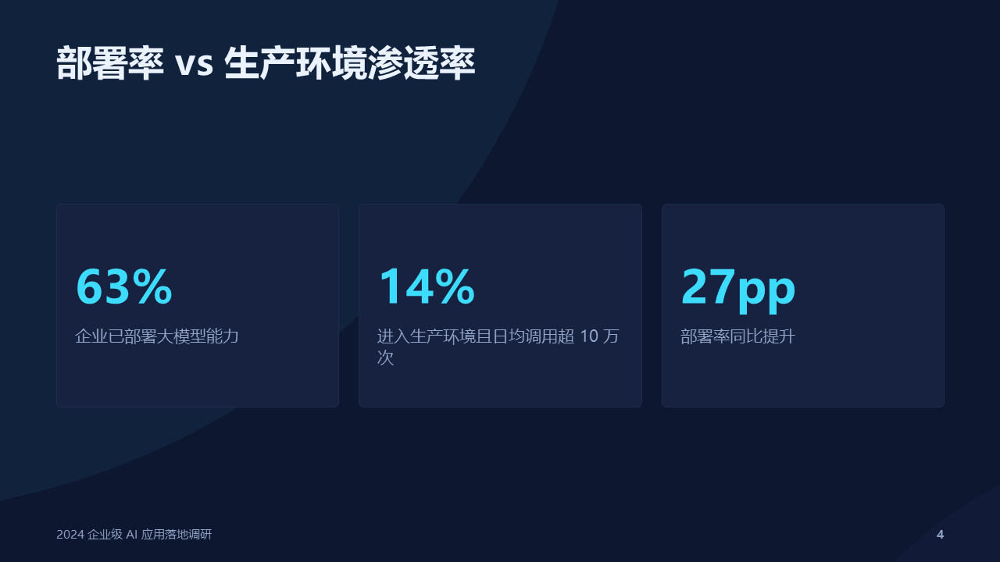 |  | 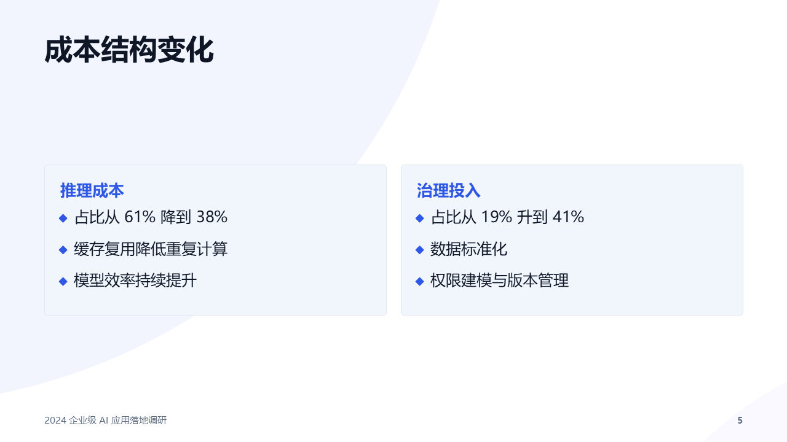 |

> `docs/screenshots/exported.pptx` 是**真实模型**生成后导出的成品，可直接用 PowerPoint / WPS 打开；
> `docs/screenshots/exported.html` 是同一份内容的独立 HTML。小程序端没有截图 ——
> 本机没有微信开发者工具，无法运行它（见下文「测试」里的说明）。

---

## 文档与调研

开发本项目的框架 API 用法通过 **Context7**（`https://context7.com/api/v1/...`）查询核对，
结论与出处整理在 [`docs/context7-cheatsheet.md`](docs/context7-cheatsheet.md)，其中确认到的关键点：

* **Express 5**：async 处理函数抛出的 Promise 拒绝会被路由自动转交 `next(err)`；
  `app.get('*')` 已不可用（通配符必须命名，如 `/*splat`）——因此本项目的 SPA 回退用普通中间件实现，跨版本安全。
* **Vite 8**（Context7 亦列出 7.3.5）：`appType: 'spa'` 时 Vite 负责 HTML 与 404 回退，
  自定义中间件必须注册在 `vite.middlewares` **之前**；本项目据此把 `/api/*` 挂在最前面。
  Node 版本要求为 `^20.19.0 || >=22.12.0`。
* **React 19**：`StrictMode` 在开发环境会重复执行 Effect，因此所有副作用都实现了可取消的清理逻辑
  （生成请求走用户点击而非 Effect，播放器在卸载时 `destroy()`）。
* **Playwright**：`channel: 'msedge'` 可直接复用本机已安装的 Edge，无需下载浏览器。

---

## 测试

```bash
npm test            # 单元 + 集成（89 个用例，全部离线、确定性）
npm run test:live   # 真实调用 deepseek-v4-pro 的接口冒烟测试（需要 .env 中的 Key）
npm run build && npm run test:e2e   # Playwright 浏览器端到端（8 个用例，mock 上游）
npm run typecheck   # 前端 TypeScript 检查

# 完整验收：真实模型 + 真实浏览器 + PowerPoint 亲自打开导出文件（需先启动服务）
npm run dev                      # 另开一个终端
npm run test:acceptance          # 输入→流式生成→演示→翻页→主题→HTML/PPTX 导出→离线→扫码→移动端

# 单独看导出的 PPTX 长什么样：生成样例 → PowerPoint 校验 → 逐页导出 PNG
npm run pptx:preview midnight
npm run pptx:validate -- -Path test-results/pptx-preview/deck.pptx -AllText -ExportPng test-results/pptx-preview/png

node scripts/screenshot.mjs      # 真实接口跑一遍并截图到 docs/screenshots
npm run sync:themes              # 改了主题后同步小程序端的主题类
```

覆盖范围：

* **单元**（`tests/unit`，50 个用例）：
  * 流式解析器：逐字符喂入、单文档容器、代码块围栏、截断、去重、上限、嵌套片段不成为页面、字符串内括号；
  * 幻灯片规范化：别名、布局推断、降级、限额、去重、bookends；
  * **PPTX**：OOXML 必需部件齐全、每个 XML 部件 well-formed（自写栈式校验）、页面尺寸是 13.333×7.5 英寸、
    每页内容落到正确的 slide 部件、备注导出、CJK 必须有 `<a:ea>` 字体（否则变豆腐块）、五套主题全部可导出；
  * **小程序工具链**：UTF-8 增量解码（按 1..17 字节切分中文）、SSE 分帧、`streamGenerate` 用假 `wx` 跑通成功/错误/降级三条路径；
  * **小程序工程**：所有 `.js` 可编译、`.json` 可解析、页面与组件文件齐全、`usingComponents`/`require`/`@import` 路径都存在、
    WXML 里的事件处理函数在对应 `.js` 里真的存在、主题生成文件与播放器运行时**完全一致**（过期即失败）。
* **集成**（`tests/integration`，31 个用例）：
  * 生成链路：SSE 事件序列、reasoning 与正文分流、参数校验（400/413/503）、上游 401 的友好提示、客户端断连后服务仍可用、上游截断仍能产出完整页面；
  * 导出链路：`/api/export/pptx` 的类型/文件名/页数/主题、坏 payload 与超限的报错、**恶意 deck 会被重新规范化而不是照单全收**；
  * 扫码链路：H5 回退二维码**用 jsQR 真实解码**（证明相机可读）、`PUBLIC_URL` 覆盖、配置微信凭据后返回小程序码（打桩微信开放接口）、
    凭据失效自动降级、**access_token 按凭据缓存（换 AppID 必须重新获取）**；
  * **Microsoft PowerPoint 亲自打开**生成的 `.pptx`（COM），核对页数、页面尺寸、每页文字、演讲者备注、无空白页；
  * **小程序的真实客户端代码**（`miniprogram/utils/api.js`）通过 `fetch` 版 `wx` 打桩直连真实后端：流式收流、
    分块切断的多字节中文、导出 pptx → 写入文件 → `openDocument` 交接。
* **端到端**（`tests/e2e`，Playwright 复用本机已安装的 Edge，无需下载浏览器）：完整流程、
  生成过程中实时预览、取消、键盘/圆点翻页、主题切换、HTML 导出文件的离线可演示性与自包含性、
  **PPTX 下载是真正的 Office 文件**、**扫码弹窗的二维码可被真实解码**、
  HTML 转义（无 XSS，导出文件同样无法被数据里的 `</script>` 逃逸）、移动端视口无横向溢出与滑动手势。
* **完整验收**（`scripts/acceptance.mjs`）：**真实模型 + 真实浏览器**跑通全部断言——
  SSE 响应类型、实时预览早于完成、页面结构（封面/结尾/版式多样性/无占位符）、
  全键盘翻页与全屏、主题循环、HTML 与 PPTX 两种导出（含 PowerPoint COM 复核）、离线文件可用、
  扫码入口可解码、手机/平板视口无溢出与滑动翻页、全流程无前端运行时错误。

> 端到端测试使用 `tests/helpers/mock-upstream.js`（本地 OpenAI 兼容 mock），因此快且稳定；
> 真实模型由 `npm run test:live` 与 `npm run test:acceptance` 覆盖。
>
> 说明：微信小程序**没有**在真机/微信开发者工具里跑过（本机没有微信开发者工具与可用 AppID），
> 因此小程序侧采用「能自动化的部分全部自动化」：工程结构静态校验 + 工具链单元测试 +
> **真实客户端代码直连真实后端**的集成测试。真机联调步骤见上文「微信小程序端」。
